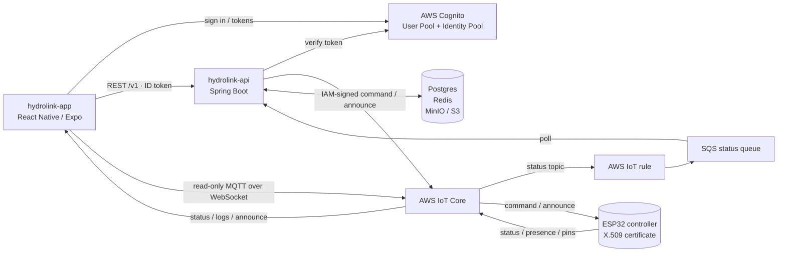
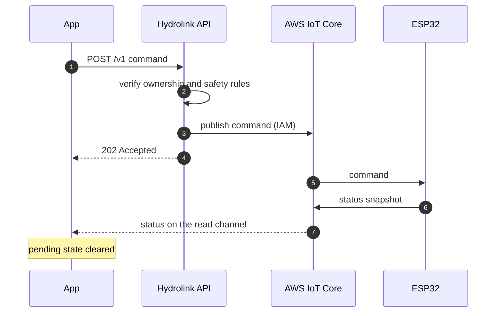

# Hydrolink

Hydrolink started with a real need: controlling the irrigation on a countryside property without
checking on it constantly. It grew into a full IoT platform where ESP32 firmware, a Spring Boot API,
and a React Native app each run a layer and control real hardware.

This repository is the mobile app — the part a person actually touches. It shows the areas they own,
the live state of every station, the upcoming watering schedule, and the firmware update waiting to
be installed.

The backend and ESP32 firmware are private. This README is the public system overview; access to the
other repositories can be arranged on request.

## Components

| Component      | Where                             | Visibility | Responsibility                                              |
| -------------- | --------------------------------- | ---------- | ----------------------------------------------------------- |
| Mobile app     | this repository (`hydrolink-app`) | public     | UI, authentication, live status, commands                   |
| Backend API    | `hydrolink-api`                   | private    | accounts, ownership, schedules, OTA, status ingest          |
| ESP32 firmware | `hydrolink-core`                  | private    | device control, provisioning, pin and station state         |
| Cloud services | AWS                               | managed    | identity, messaging, data, and hosting                      |

## What works today

- Sign in, register, confirm, and manage the account through AWS Cognito
- Link and unlink irrigation areas with a QR code or a link code
- Live area and station status, streamed from AWS IoT Core
- Start and stop supported stations, with the pending-until-confirmed contract
- Per-day watering schedules with fixed or relative time windows
- Firmware update notifications with a tap-to-install OTA flow
- English and Spanish translations

## Stack

- React Native 0.86 with Expo SDK 57 and Expo Router, using a custom development build
- React 19 and TypeScript, React Compiler enabled
- AWS Cognito (User Pool + Identity Pool) through Amplify v6
- AWS IoT Core for live device status, over MQTT-over-WebSocket with SigV4
- TanStack Query for server state, persisted to AsyncStorage
- Zustand for local device state, XState for the station action machine
- Zod for validating API responses and inbound MQTT payloads

## Architecture

There are two paths through the system: a **read path** for live state and a **write path** for
actions.

**Read.** Devices publish complete snapshots to AWS IoT Core. An IoT rule forwards them to an SQS
queue, and the API polls that queue to persist the state. The app also subscribes directly to IoT
Core for its devices, over a read-only MQTT-over-WebSocket connection with temporary credentials.

**Write.** Every action is a REST call to the API. The API checks ownership and safety rules,
publishes to the device with IAM, and returns `202 Accepted`. The station stays pending until the
device reports the new state on the read path.

The app is deliberately on the read side of the bus: it subscribes to device topics, and every write
goes through the API, so ownership and safety rules live in one place.



A command is only done when the device says so:



## How it works

**Identity.** Cognito owns identity. The app signs in against the user pool and sends the ID token to
the API, which validates it as an OAuth2 resource server and maps the Cognito subject to a local user
row. Two identities stay separate: the user pool subject authenticates API calls, while the identity
pool id is what AWS IoT sees and what per-device policies attach to. The API resolves the identity
pool id server-side when linking or unlinking an area. Sensitive changes, such as an email change,
require a recent login.

**Setup and provisioning.** The device creates its application-side record when firmware boots; the
AWS Thing is provisioned separately through AWS IoT claim provisioning. The two never share an
identifier. An ownership secret links the device to an account through a QR code or link code, and
mDNS lets the app find the device on the local network before the cloud round trip finishes.

**Live status.** Devices publish complete snapshots to `hydro/{deviceKey}/status`: presence, pin
configuration, station state, schedules, and logs. The IoT rule stamps `topic(2)` as `deviceKey` and
forwards each message to SQS; the API upserts the state it carries. Because SQS delivers at least
once and payloads are full snapshots, duplicates converge and no ordering is assumed. The app
receives status, logs, and announcements on its read-only channel.

**Commands.** Start, stop, reboot, and OTA install go through the API, which publishes to
`hydro/{deviceKey}/command` or `/announce` and returns `202`. The UI keeps the station pending until
the device reports the new state; a timeout clears it.

**Schedules.** Per-day schedules with fixed or relative time windows. The API persists them, pushes
them to the device, and returns any conflicting windows in the response.

**Firmware updates.** Firmware is uploaded with a version and checksum, stored in object storage,
and announced to matching devices. A forced install can recover a device reporting the wrong
version. The app starts the install through the command path.

**Secret rotation.** A regenerated device secret becomes authoritative only after the device
acknowledges it, so a failed rotation cannot strand a device.

## Backend modules

The API is a modular monolith. Spring Modulith keeps each domain behind a boundary, with cross-module
access going through a small published interface.

| Module      | Owns                                                            |
| ----------- | --------------------------------------------------------------- |
| `users`     | accounts, roles, profile, Cognito subject binding, link/unlink  |
| `devices`   | device records, ownership secrets, pins, provisioning, rotation |
| `schedules` | per-day schedules and time windows, pushed to devices           |
| `storage`   | object uploads and the OTA firmware lifecycle                   |
| `config`    | security, Cognito client, command gateway, AWS and storage config |

## Device layer

- ESP32 controller with closed-source firmware.
- Connects to AWS IoT Core over MQTT/TLS with a fleet-provisioned X.509 certificate.
- Publishes status, presence, pin configuration, and station state; subscribes to command and
  announce topics.
- Sends complete snapshots, not deltas.
- AWS IoT policies restrict the backend to the exact command and announce topic shapes.
- Neither the app nor the API holds a device certificate; devices authenticate with their own.

## Data and deployment

- PostgreSQL 16 for application data, Redis for cache, and object storage for firmware and images
  (MinIO locally, S3 on AWS).
- AWS IoT Core is the single message bus; the earlier self-hosted MQTT broker was retired.
- AWS CDK (Java) provisions the VPC, RDS, ElastiCache Serverless, SQS with a dead-letter queue, IAM
  roles, ECS Fargate, and an internet-facing ALB. The stack is pinned to `eu-west-1`.
- Stage and production resolve AWS credentials from IAM task roles, with no static keys.
- Docker Compose can run the API with Postgres, Redis, and MinIO on a single host.
- Public and internal OpenAPI specifications are separate, so internal endpoints are not part of the
  consumer contract.

## App details

- **The read channel.** `services/mqtt.ts` presigns the IoT WebSocket URL with SigV4. With temporary
  credentials, AWS IoT's endpoint appends the session token after signing rather than folding it into
  the canonical request. A per-connection nonce keeps the client id unique across reconnects.
- **Images by object key.** Uploads persist the object key, not a presigned URL. Reads mint a fresh
  signed URL server-side, so stored images never expire.

## App structure

| Path                | What it holds                                                                                |
| ------------------- | -------------------------------------------------------------------------------------------- |
| `app/`              | Expo Router routes: onboarding, auth, tabs, area, schedules, settings                        |
| `components/`       | UI by domain: areas, dashboard, schedules, profile, settings, status, and a shared `ui/` kit |
| `context/`          | MQTT lifecycle, network state, theme tokens                                                  |
| `services/`         | Amplify config, the AWS IoT read channel, device commands, OTA notifications                 |
| `queries/`          | TanStack Query fetchers and the persisted query client                                       |
| `mutations/`        | API write functions: areas, profile, schedules, storage                                      |
| `stores/`           | Zustand stores: areas, discovery, logs, header, onboarding                                   |
| `i18n/`, `locales/` | Translation helper and the English and Spanish dictionaries                                  |

## Run locally

Requirements: Node (or Bun), and a development build. Expo Go will not work because the app uses
native modules for MQTT, mDNS discovery, and the camera. Copy `.env.example` to `.env.local` and
fill in the values; the app only reads `EXPO_PUBLIC_*` variables.

```bash
cp .env.example .env.local   # API base URL and the Cognito / IoT values
bun install                  # or npm install
bun run android              # build and run a dev client (or: bun run ios)
```

Other scripts:

- `bun start` starts Metro for an already-installed dev build
- `bun run lint` runs ESLint through `expo lint`

The AWS values are not secrets. The user pool id, app client id, identity pool id, region, and IoT
endpoint are all public identifiers, but they are kept in env so the same build can point at a dev
or production stack. `EXPO_PUBLIC_API_BASE_URL` must include the API version prefix the backend
expects (for example `.../v1`); the app appends only the resource path to it.

The backend is a private repository. To run the app against a local stack you need access to it, or
a configured dev stack; the app itself only needs the API base URL and the Cognito / IoT identifiers.

## License

Released under the
[Creative Commons Attribution-NonCommercial 4.0 International](LICENSE) license. Noncommercial use
is fine; any other use needs permission.
